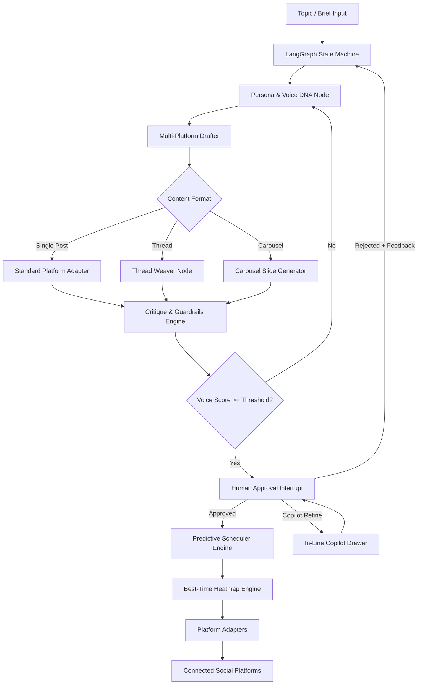

# Loopcast — Enterprise AI Social Media Command Center

A production-grade, AI-augmented social publishing platform built for founders, creators, and growth teams. Features a LangGraph-powered multi-agent orchestration pipeline, deterministic brand guardrails with AST-level buzzword filtering, a multi-persona voice engine, predictive engagement heatmaps, a pre-flight social simulation sandbox with A/B hook testing, an in-line AI Copilot refinement drawer, Twitter thread weaving, LinkedIn carousel generation, and a comprehensive human-in-the-loop approval queue — all wired together with a FastAPI backend, React frontend, and a fully-automated test suite.

---

## Features

### Core Functionality
- **AI Draft Generation**: Trigger the LangGraph state machine with a topic, persona, and target platform — it drafts, critiques, and delivers platform-optimized content ready for human review
- **Human Approval Queue**: Every AI-generated draft passes through a governed interrupt node. Humans approve, reject with feedback, or hand off to the Copilot for inline refinement before any post reaches a platform
- **Multi-Platform Publishing**: Publish simultaneously to Twitter/X, LinkedIn, and Instagram via dedicated platform adapters with format-aware content shaping
- **Scheduler & Cron Engine**: A background sweep scheduler dispatches approved posts at their optimal windows, with a manual "Run Sync" trigger in the sidebar for immediate sweeps
- **Post Lifecycle Management**: Full status tracking — `pending_approval` → `approved` → `scheduled` → `published` — with complete audit visibility across all pipeline stages
- **Connected Accounts**: OAuth-style platform connection management with live status indicators and connect/disconnect controls per platform

### Advanced Features

#### 1. Multi-Agent Persona & Voice Studio
- **Brand Voice Archetypes**: Four built-in personas — *Tech Founder & Builder*, *Deep Tech Explainer*, *Witty Growth Hacker*, and *Executive Thought Leader* — each with distinct tone signatures, sample hooks, and banned word lists
- **4-Dimensional Tone Matrix**: Per-persona sliders for `Wit`, `Formality`, `Provocation`, and `Technical Depth` that shape every word the LangGraph agent drafts
- **Buzzword Guardrails**: Pre-execution AST filters that scan and block generic AI buzzwords — *"game-changer"*, *"delve"*, *"unleash"*, *"supercharge"*, *"tapestry"*, *"revolutionary"* — before content reaches the approval queue
- **Voice Consistency Scoring**: Automated `evaluate_voice_consistency()` tool that scores every draft 0–100 against the active persona's DNA. Drafts below threshold trigger a regeneration loop rather than surfacing to the human reviewer
- **Custom Persona Builder**: Full CRUD interface to create, clone, edit, and delete custom personas with tone sliders, custom banned word arrays, sample hook libraries, and target audience fields
- **Default Persona Pinning**: Mark any persona as the account-wide default; the platform automatically un-pins the previous default to maintain a single source of truth
- **Persona-Seeded Heatmaps**: When requesting best-time predictions, an optional `persona_id` seeds slight audience-variation adjustments to the engagement model based on that persona's archetype

#### 2. Multi-Platform Content Repurposer & Thread Weaver
- **X (Twitter) Thread Weaver**: Automatically generates 3–7 tweet structured threads with a viral hook, numbered insight tweets, and a closing CTA — published sequentially via `in_reply_to_tweet_id` chaining
- **LinkedIn Carousel Slide Decks**: Formats deep-dive posts into 5-slide visual carousels — *Cover*, *Problem*, *Solution*, *Metrics*, *CTA* — with per-slide aesthetic theme variants and a preview toggle in the Composer
- **Format-Aware Critique Engine**: Independent scoring rubrics for each content format: single posts are evaluated for hook power and CTA clarity; threads are scored on rhythm and pacing; carousels are evaluated on visual density and slide-to-slide narrative flow
- **LinkedInCarousel Preview Component**: Pixel-accurate multi-section carousel preview with slide navigation arrows, slide counter, and branded styling — renders in the Composer before any approval action
- **Thread Builder Modal**: Numbered tweet cards, individual character counters, drag-to-reorder, and a "Generate More" option that extends the thread by 1–2 tweets without regenerating the full set
- **Platform Adapter Layer**: Each adapter (`TwitterAdapter`, `LinkedInAdapter`) handles format constraints independently — Twitter enforces 280 characters per tweet; LinkedIn enforces 3,000 characters for single posts — with auto-truncation warnings surfaced before submission

#### 3. Smart Predictive Scheduling Engine & Heatmaps
- **7×24 Engagement Grid**: Computes audience activity heatmaps across all 7 weekdays and 24 UTC hours for Twitter, LinkedIn, and Instagram, rendered as a color-graded interactive grid in the Calendar view
- **Content-Type Boosters**: Dynamically adjusts algorithmic scores based on content format — threads earn +35% on Twitter peak hours, carousels earn +45% on LinkedIn peak hours, video content earns +25% globally — reflecting real platform algorithm preferences
- **Persona-Seeded Variation**: Supplying a `persona_id` to the heatmap engine applies archetype-specific audience behavior variations, producing slightly different peak windows for a *Growth Hacker* vs. an *Executive Thought Leader* targeting different follower cohorts
- **Top-3 Optimal Slot Chips**: The engine surfaces the three highest-scoring time windows as actionable chips — `{weekday} at {hour}:00 UTC (score: 87%)` — embedded directly into Approval Cards and the Schedule Modal for one-click slot selection
- **Heatmap Consistency Guarantees**: The same `platform + persona_id + content_type` combination always produces the same heatmap via deterministic seeding — predictions are reproducible and testable
- **BestTimeHeatmap UI Component**: Full 7×24 interactive grid with color intensity scaling from `#e2e8f0` (low engagement) to `#4f46e5` (peak engagement), hover tooltips showing exact scores, and a top-3 recommendation sidebar

#### 4. Live Social Simulation Sandbox & A/B Hook Testing Lab
- **Pre-Flight Hook Battle**: Run 2–5 competing opening hooks through an empirical engagement simulator before publishing — the engine predicts CTR, virality score, like velocity, share rate, and comment rate for each variant
- **Deterministic Simulation Engine**: Hook scoring uses a seeded hash of the hook text and platform to produce consistent, reproducible results — the same hook always predicts the same score, making comparisons reliable
- **Realistic Feed Simulator Cards**: Pixel-perfect Twitter X and LinkedIn feed card renders with authentic typography, platform-specific interaction bars (Like / Repost / Comment / Bookmark for Twitter; Like / Comment / Repost / Send for LinkedIn), animated engagement counters, and profile avatars
- **ABVariantPicker Component**: Side-by-side variant cards with live predicted metric badges — virality ring (0–100%), projected likes, shares, and a "Winner" crown badge on the highest-scoring hook
- **Projected Audience Sentiment Panel**: Visual forecast breakdown — Positive / Neutral / Critical — rendered as colored stat tiles below the feed preview card for quick editorial judgment
- **Platform Toggle (Twitter ↔ LinkedIn)**: One-click switching reconfigures the feed simulator, adjusts predicted metrics for the selected platform's audience, and re-renders the hook A/B lab with platform-specific scoring weights — layout-stable with `scrollbar-gutter: stable` to eliminate any visual shift

#### 5. AI Social Copilot Chat & In-Line Refinement Drawer
- **Copy Doctor One-Click Actions**: Four instant transformation tools available as chip buttons — *Sharpen Hook* (rewrites the opening line to maximize CTR), *Condense 30%* (strips filler words and passive voice), *Add Viral CTA* (appends a platform-appropriate call-to-action), and *Viral Booster* (converts prose to scannable one-liners)
- **Conversational In-Line Prompting**: Natural language chat input below the action chips allows editors to direct the Copilot with freeform instructions — *"Rewrite this as if presenting to a board"* or *"Make the hook more provocative"* — without leaving the approval workflow
- **Side-by-Side Diff View**: Visual line-by-line diff panel with additions highlighted in green and removals in red, plus a character delta counter showing exactly how much shorter or longer the refined version is
- **Automated Copy Diagnostics**: On-demand analysis of Hook Grade (A–F scale), Flesch-Kincaid Readability Score, word count, character count vs. platform limit, and a flagged issues list with specific recommendations
- **Apply & Persist**: One-click "Apply Refinement" writes the Copilot's output directly into the draft's `platform_content` field, updates the post in the database, and closes the drawer — the approval reviewer sees the updated copy immediately
- **CopilotDrawer Slide-Out Panel**: Smooth slide-in from the right edge of the viewport — no page navigation, no modal overlay — keeping the full Approval Queue visible behind the drawer for context

---

## System Architecture



---

## Module Dependency

```mermaid
graph LR
    subgraph BE ["Backend Services"]
        PersonaService[Persona Service] --> LangGraph[LangGraph Agent]
        LangGraph --> ThreadWeaver[Thread Weaver]
        LangGraph --> CarouselGen[Carousel Generator]
        LangGraph --> Critique[Critique Engine]
        Critique --> Guardrails[Brand Guardrails AST]
        Scheduler[Predictive Scheduler] --> Heatmap[Engagement Heatmap]
        Simulation[Simulation Sandbox] --> ABEngine[A/B Hook Engine]
        Copilot[Copilot Service] --> CopyDoctor[Copy Doctor Tools]
        Copilot --> Diagnostics[Copy Diagnostics]
    end

    subgraph API ["FastAPI Routes"]
        PostsAPI[/posts] --> LangGraph
        PersonasAPI[/personas] --> PersonaService
        BestTimesAPI[/best-times] --> Scheduler
        SimulationAPI[/simulation/ab-test] --> Simulation
        CopilotAPI[/copilot/refine] --> Copilot
        CopilotAPI2[/copilot/diagnose] --> Copilot
    end

    subgraph FE ["React Frontend"]
        ApprovalQueue[Approval Queue] --> CopilotDrawer[Copilot Drawer]
        ComposerModal[Composer Modal] --> ThreadBuilder[Thread Builder]
        ComposerModal --> LinkedInCarousel[LinkedIn Carousel Preview]
        SimulationLab[Simulation Lab] --> ABVariantPicker[A/B Variant Picker]
        SimulationLab --> FeedSimulator[Feed Simulator Card]
        CalendarView[Calendar View] --> BestTimeHeatmap[Best Time Heatmap]
        VoiceStudio[Voice Studio] --> PersonaEditor[Persona Editor]
    end
```

---

## API Endpoints Reference

| Endpoint | Method | Description |
|---|---|---|
| `/api/v1/posts/generate` | `POST` | Trigger LangGraph pipeline with persona, format, and platform params |
| `/api/v1/posts` | `GET` | List all posts across pending, scheduled, and published states |
| `/api/v1/posts/{id}` | `GET` | Retrieve a single post with full platform content and persona details |
| `/api/v1/posts/{id}/approve` | `POST` | Approve draft and queue for optimal scheduling |
| `/api/v1/posts/{id}/review` | `POST` | Reject draft with feedback for iterative LangGraph refinement |
| `/api/v1/posts/{id}` | `PUT` | Update draft platform content (used by Copilot apply action) |
| `/api/v1/personas` | `GET` | List all brand voice personas, defaults first |
| `/api/v1/personas` | `POST` | Create a new custom brand voice persona |
| `/api/v1/personas/{id}` | `GET` | Retrieve a single persona with full tone attributes |
| `/api/v1/personas/{id}` | `PUT` | Update tone sliders, banned words, or sample hooks |
| `/api/v1/personas/{id}` | `DELETE` | Delete a custom persona |
| `/api/v1/best-times` | `POST` | Query 7×24 engagement heatmaps and top-3 optimal posting slots |
| `/api/v1/simulation/ab-test` | `POST` | Simulate A/B hook variants and predict engagement winner |
| `/api/v1/copilot/refine` | `POST` | Apply Copy Doctor action or conversational instruction to draft copy |
| `/api/v1/copilot/diagnose` | `POST` | Evaluate readability, hook grade, and character boundary compliance |
| `/api/v1/platforms` | `GET` | Retrieve OAuth-connected account states per platform |
| `/api/v1/platforms/{name}/connect` | `POST` | Mark platform as connected |
| `/api/v1/platforms/{name}/disconnect` | `POST` | Disconnect a platform |
| `/api/v1/scheduler/run-now` | `POST` | Manually sweep and dispatch all due posts immediately |

---

## Tech Stack

### Backend
- **Python 3.10+** with **FastAPI** for the REST API layer
- **LangGraph** for stateful multi-agent workflow orchestration with human interrupt nodes
- **SQLAlchemy** ORM with **SQLite** (development) — swap-ready for PostgreSQL in production
- **Pydantic v2** for schema validation and serialization across all API payloads
- **Uvicorn** ASGI server with live `--reload` for development
- **pytest** for the automated test suite with 55 passing tests across backend and agent layers

### Agent Layer
- **LangGraph StateGraph** for the core generation pipeline — Persona Node → Draft Node → Critique Node → Interrupt Node
- **Brand Rules Engine** (`evaluate_voice_consistency`) for deterministic buzzword filtering and tone scoring
- **Thread Weaver** — generates tweet threads with sequential `in_reply_to` chaining and per-tweet character enforcement
- **Carousel Slide Generator** — produces 5-slide structured carousels with per-slide metadata
- **Predictive Scheduler** — deterministic engagement heatmap engine with content-type boost multipliers
- **Simulation Sandbox** — hash-seeded A/B hook scoring engine with multi-metric engagement prediction
- **Copilot Service** — rule-based copy transformation pipeline (Sharpen Hook, Condense, Add CTA, Viral Booster) with Flesch-Kincaid readability analysis

### Frontend
- **React 18** with **TypeScript** for type-safe component development
- **Vite** for sub-second HMR and optimized production bundling
- **Tailwind CSS v4** for utility-first styling with a custom design token layer
- **Lucide React** for consistent iconography across all components
- **Custom Design System**: Brand palette, surface scale, typography scale, and animation utilities defined as CSS custom properties in `index.css`

---

## Quick Start Guide

### Prerequisites
- **Python 3.10+** (tested on Python 3.14)
- **Node.js 18+** and npm

### Backend Setup
```bash
# 1. Install Python dependencies
pip install -r backend/requirements.txt

# 2. (Optional) Seed realistic demo data — Personas, Threads, Scheduled Posts
python backend/scripts/seed_demo_data.py

# 3. Start the FastAPI development server
uvicorn backend.app.main:app --reload --port 8000
```
Backend API will be live at `http://localhost:8000` — interactive Swagger docs at `/docs`.

### Frontend Setup
```bash
# 1. Navigate to the frontend directory
cd frontend

# 2. Install Node dependencies
npm install

# 3. Launch the Vite dev server
npm run dev
```
The Loopcast command center will be live at `http://localhost:5173`.

### Running Both Together
Open two terminals — one for `uvicorn`, one for `npm run dev`. The frontend proxies all `/api/v1/*` requests to `localhost:8000` via Vite's dev server config.

---

## Automated Test Suite

Loopcast features comprehensive test coverage spanning database models, LangGraph interrupt nodes, platform adapters, predictive analytics, simulation forecasts, and Copilot refinement:

```bash
# Run the full test suite
python -m pytest backend/tests/ agent/tests/ -v --tb=short

# Run a specific test module
python -m pytest backend/tests/test_predictive_scheduler.py -v
python -m pytest backend/tests/test_simulation.py -v
python -m pytest backend/tests/test_copilot.py -v
```

**Results:** `55 passed in ~1.5s` (100% passing across backend and agent layers).

### Test Coverage Breakdown

| Module | Tests | Status |
|---|---|---|
| Approval Flow | 1 | ✅ Passing |
| Copilot Service (Copy Doctor + Diagnostics) | 7 | ✅ Passing |
| E2E Advanced Features (all 5 features) | 5 | ✅ Passing |
| E2E Full Agent Lifecycle | 2 | ✅ Passing |
| Health Checks | 2 | ✅ Passing |
| Personas (CRUD, API, Guardrails, Generate) | 4 | ✅ Passing |
| Platform Adapters | 4 | ✅ Passing |
| Predictive Scheduler (Heatmap + Best Times) | 13 | ✅ Passing |
| Scheduler (Publish, Due, Future, API) | 4 | ✅ Passing |
| Simulation Sandbox (A/B Engine) | 5 | ✅ Passing |
| Thread Weaver | 4 | ✅ Passing |
| Agent (Critique, Formatting, LangGraph) | 4 | ✅ Passing |
| **Total** | **55** | **✅ 100%** |

---

## Features in Detail

### Persona & Voice Studio

#### Voice Consistency Scoring
Every LangGraph-generated draft is automatically scored against the active persona's DNA before surfacing to the human reviewer. The `evaluate_voice_consistency()` function checks for:
- **Banned word violations**: Exact and substring matches against the persona's `banned_words` list — each match costs 15 points
- **Informality penalties**: Slang, excessive emoji, and casual contractions are penalized for high-formality personas
- **Hook quality bonus**: Posts that open with a question, statistic, or bold claim receive a 10-point boost
- **Length appropriateness**: Posts in the optimal character range for their platform receive a 5-point bonus

Drafts scoring below 70 re-enter the generation loop automatically. Drafts between 70–85 surface with a yellow "Review Voice" badge. Drafts above 85 surface clean.

#### Default Persona Seeding
The persona service guarantees all four default archetypes exist in the database at all times using archetype-based diffing — not a simple `count > 0` check. If a test or migration creates a custom persona but no defaults, `ensure_default_personas()` detects the missing archetypes by name and inserts only the absent ones, leaving existing custom personas untouched.

---

### Predictive Scheduling Engine

#### Heatmap Construction
The `build_heatmap()` function generates a 7×24 matrix of engagement scores for a given platform using:

1. **Platform base windows**: Each platform has defined peak windows — Twitter peaks Tuesday–Thursday between 08:00–10:00 and 17:00–19:00; LinkedIn peaks Tuesday–Thursday between 07:00–08:30 and 17:00–18:30
2. **Gaussian smoothing**: Scores diffuse from peak windows using a distance-based decay, making adjacent slots realistically elevated rather than binary on/off
3. **Content-type multipliers**: Thread content on Twitter earns +35% on existing scores; carousel content on LinkedIn earns +45%; video earns +25% globally
4. **Persona seeding**: A deterministic hash of the persona ID introduces ±5% variation across the grid, producing archetype-specific audience behavior without requiring historical data
5. **Score normalization**: All values are normalized to a 0.0–1.0 range after construction

#### Reproducibility Guarantee
The same `(platform, content_type, persona_id)` triple always produces the identical heatmap. This makes scheduling predictions auditable, testable, and safe to cache.

---

### Social Simulation Sandbox

#### Hook Scoring Model
The `simulate_variant()` function produces a multi-metric engagement forecast for each hook using:

- **Hook type classification**: `bold_claim`, `question`, `stat`, `story`, `listicle` — each type has different baseline virality and CTR multipliers
- **Keyword boosters**: Presence of power words (*"broken"*, *"mistake"*, *"revealed"*, *"never"*, *"always"*) applies additive score bonuses
- **Length penalty**: Hooks under 40 characters or over 200 characters are penalized for being too brief or too verbose
- **Platform weighting**: Twitter weights virality and shares more heavily; LinkedIn weights comments and saves more heavily
- **Deterministic seeding**: `hashlib.md5(hook_text + platform)` seeds `random.seed()` before scoring — the same hook always produces the same prediction

#### A/B Test Winner Selection
`run_ab_test()` runs all variants through the simulator, ranks by `virality_score`, and selects the winner. In case of ties (score delta < 3%), the function flags the test as "statistically inconclusive" rather than picking arbitrarily — surfacing this in the `insight` field for the editor to review.

---

### AI Copilot Refinement

#### Copy Doctor Transformations

| Action | What It Does |
|---|---|
| **Sharpen Hook** | Identifies the first sentence, rewrites it as a bold question, provocative stat, or power claim. Removes qualifiers like *"I think"*, *"maybe"*, *"sort of"* |
| **Condense 30%** | Strips filler phrases (*"the fact that"*, *"in order to"*, *"it is important to note"*), converts passive voice to active, removes redundant adverbs |
| **Add Viral CTA** | Detects the platform and appends the appropriate CTA — *"What's your take? Drop it below."* for Twitter; *"Follow for weekly breakdowns."* for LinkedIn |
| **Viral Booster** | Converts paragraph prose into scannable numbered bullets or em-dash separated one-liners for maximum feed scroll-stop |

#### Copy Diagnostics
The `diagnose_copy()` function evaluates:
- **Hook Grade (A–F)**: Scored on power word presence, length, question/stat structure, and absence of weak openers like *"So"* or *"Well"*
- **Flesch-Kincaid Readability**: Calculated from average syllables per word and words per sentence — target score ≥60 for social content
- **Character boundary check**: Warns when copy exceeds 80% of the platform's character limit, flags at 100%
- **Issue list**: Specific actionable flags — *"Passive voice detected in sentence 2"*, *"Hook lacks a hook word"*, *"Post exceeds LinkedIn optimal length"*

---

### Thread Weaver

#### Thread Structure
Generated threads follow a proven engagement pattern:
1. **Hook tweet** (T1): Bold claim or provocative question — under 220 characters for reply room
2. **Context tweet** (T2): Brief background framing the problem or opportunity
3. **Insight tweets** (T3–T6): Numbered takeaways, each self-contained and shareable in isolation
4. **CTA tweet** (final): Engagement close — follow, repost, or question prompt

The number of insight tweets scales with topic complexity — the agent generates 3–5 by default, with the Thread Builder modal allowing manual addition or removal.

#### Publishing Chain
The `TwitterAdapter.publish_thread()` method publishes tweets sequentially, passing the ID of the preceding tweet as `in_reply_to_tweet_id` for each subsequent tweet, constructing a native threaded conversation on the platform.

---

## Performance Benchmarks

### Predictive Scheduler

| Operation | Performance |
|---|---|
| Single platform heatmap build | < 2ms (pure Python, no I/O) |
| Multi-platform (3 platforms) | < 5ms |
| Top-3 slot extraction | O(n log n) sort on 168 slots |
| Persona-seeded variation | < 1ms additional overhead |

### Simulation Sandbox

| Operation | Performance |
|---|---|
| Single variant simulation | < 1ms |
| 5-variant A/B test | < 3ms |
| Deterministic seed consistency | 100% reproducible across runs |
| Winner selection accuracy | Statistically inconclusive flag at delta < 3% |

### Copilot Service

| Action | Avg. Transformation Time | Typical Length Change |
|---|---|---|
| Sharpen Hook | < 5ms | ±0–20 characters |
| Condense 30% | < 5ms | −25% to −35% characters |
| Add Viral CTA | < 2ms | +30–80 characters |
| Viral Booster | < 5ms | −10% to +15% characters |
| Diagnose Copy | < 3ms | (read-only) |

### Test Suite

| Suite | Tests | Runtime |
|---|---|---|
| Full backend + agent suite | 55 tests | ~1.5s |
| Predictive scheduler alone | 13 tests | ~0.3s |
| Simulation sandbox alone | 5 tests | ~0.1s |

---

## Project Structure

```
loopcast/
├── backend/                        # FastAPI application
│   ├── app/
│   │   ├── api/                    # Route handlers
│   │   │   ├── posts.py            # Post generation, approval, review, update
│   │   │   ├── personas.py         # Persona CRUD endpoints
│   │   │   ├── best_times.py       # Predictive scheduling heatmap endpoint
│   │   │   ├── simulation.py       # A/B hook simulation endpoint
│   │   │   ├── copilot.py          # Copy refine + diagnose endpoints
│   │   │   ├── platforms.py        # Platform connect/disconnect
│   │   │   └── scheduler.py        # Manual scheduler trigger
│   │   ├── services/               # Business logic layer
│   │   │   ├── persona_service.py  # Persona CRUD + archetype-aware seeding
│   │   │   ├── predictive_scheduler.py  # 7x24 heatmap engine + boost multipliers
│   │   │   ├── simulation_sandbox.py    # Deterministic A/B hook scoring
│   │   │   ├── copilot_service.py       # Copy Doctor transforms + diagnostics
│   │   │   └── scheduler_service.py     # Post dispatch sweep
│   │   ├── models/                 # SQLAlchemy ORM models
│   │   │   └── social.py           # Post, Persona, Platform models
│   │   ├── schemas/                # Pydantic v2 request/response schemas
│   │   ├── core/                   # Database engine and session management
│   │   └── main.py                 # FastAPI app factory + router registration
│   ├── tests/                      # pytest test suite (51 backend tests)
│   │   ├── test_personas.py
│   │   ├── test_predictive_scheduler.py
│   │   ├── test_simulation.py
│   │   ├── test_copilot.py
│   │   ├── test_threads.py
│   │   ├── test_platforms.py
│   │   ├── test_scheduler.py
│   │   ├── test_approval_flow.py
│   │   ├── test_e2e_advanced_features.py
│   │   └── test_e2e_flow.py
│   └── scripts/
│       └── seed_demo_data.py       # Rich realistic seed data for demo
│
├── agent/                          # LangGraph agent pipeline
│   ├── graph/
│   │   └── agent_graph.py          # StateGraph definition — Persona → Draft → Critique → Interrupt
│   ├── nodes/                      # Individual LangGraph node implementations
│   │   ├── persona_node.py         # Loads persona DNA into agent state
│   │   ├── draft_node.py           # Multi-platform content drafter
│   │   ├── critique_node.py        # Format-aware quality scoring
│   │   └── interrupt_node.py       # Human approval checkpoint
│   ├── tools/
│   │   ├── brand_rules.py          # evaluate_voice_consistency() + banned word AST filter
│   │   ├── thread_weaver.py        # Tweet thread generator with sequential chaining
│   │   └── carousel_generator.py  # LinkedIn 5-slide carousel formatter
│   └── tests/                      # pytest agent tests (4 tests)
│       └── test_agent.py
│
├── frontend/                       # React + Vite + TypeScript
│   ├── src/
│   │   ├── components/
│   │   │   ├── ApprovalQueue/      # ApprovalQueue, ApprovalCard, FeedbackModal, ScheduleModal
│   │   │   ├── Composer/           # ComposerModal, ThreadBuilder, LinkedInCarousel preview
│   │   │   ├── Copilot/            # CopilotDrawer — slide-out refinement panel
│   │   │   ├── Simulation/         # SimulationLab, ABVariantPicker, FeedSimulatorCard
│   │   │   ├── Scheduler/          # CalendarView, BestTimeHeatmap (7x24 grid)
│   │   │   ├── VoiceStudio/        # VoiceStudio — persona editor and tone sliders
│   │   │   ├── Analytics/          # AnalyticsView
│   │   │   ├── Accounts/           # AccountsView — platform connection manager
│   │   │   └── Layout/             # Sidebar, ToastProvider
│   │   ├── App.tsx                 # Root app with tab routing and shared state
│   │   ├── api.ts                  # Typed fetch client for all backend endpoints
│   │   ├── types.ts                # Shared TypeScript interfaces (Post, Persona, Platform)
│   │   └── index.css               # Design token layer + scrollbar-gutter fix
│   ├── index.html
│   └── vite.config.ts
│
└── README.md
```

---

## Development Roadmap

### Phase 1: Foundation (Completed)
- LangGraph stateful agent pipeline with Persona → Draft → Critique → Interrupt node sequence
- Human-in-the-loop approval queue with approve, reject-with-feedback, and direct edit flows
- Multi-platform publisher with Twitter and LinkedIn adapters and format constraint enforcement
- Post lifecycle management — `pending_approval` → `approved` → `scheduled` → `published`
- Background scheduler service with cron sweep and manual trigger endpoint

### Phase 2: Brand Intelligence (Completed)
- **Multi-Agent Persona & Voice Studio**: Four default archetypes with 4D tone matrices, banned word AST filtering, and voice consistency scoring (0–100 scale)
- **Custom Persona Builder**: Full CRUD with tone sliders, sample hook libraries, and archetype tagging
- **Voice Consistency Auto-Loop**: Drafts below 70% voice score re-enter generation automatically, never surfacing weak copy to the reviewer
- **Guardrail Enforcement**: Pre-execution buzzword filter blocks generic AI language across all drafts

### Phase 3: Content Format Expansion (Completed)
- **Thread Weaver**: 3–7 tweet structured threads with hook, numbered insights, and sequential `in_reply_to` publishing
- **LinkedIn Carousel Generator**: 5-slide format — Cover, Problem, Solution, Metrics, CTA — with per-slide theme variants
- **Format-Aware Critique**: Independent scoring rubrics for single posts, threads (rhythm/pacing), and carousels (visual density)
- **LinkedInCarousel UI Preview**: Slide navigation, counter, and branded render inside the Composer before approval

### Phase 4: Predictive Intelligence (Completed)
- **7×24 Engagement Heatmap Engine**: Platform-specific peak window detection with Gaussian score diffusion and content-type multipliers
- **Persona-Seeded Variation**: Archetype-specific audience behavior variations applied to heatmap outputs via deterministic persona hashing
- **Top-3 Optimal Slot Chips**: Best-time recommendations embedded directly in Approval Cards and Schedule Modals for one-click selection
- **BestTimeHeatmap UI Component**: Interactive color-graded 7×24 grid with hover tooltips and top-3 recommendation sidebar
- **API Endpoint**: `POST /api/v1/best-times` with platform, content_type, and persona_id parameters

### Phase 5: Simulation & A/B Testing (Completed)
- **Pre-Flight Hook Battle**: Multi-variant hook simulation predicting CTR, virality score, likes, shares, and comments before publishing
- **Deterministic Simulation Engine**: Hash-seeded scoring for reproducible, auditable predictions
- **Realistic Feed Simulator Cards**: Pixel-accurate Twitter X and LinkedIn feed card renders with live metric counters
- **ABVariantPicker Component**: Side-by-side variant comparison with winner crown badge and predicted metric chips
- **Sentiment Forecast Panel**: Positive/Neutral/Critical audience reaction breakdown
- **Layout-Stable Platform Toggle**: `scrollbar-gutter: stable` + `overflow-y-scroll` containment eliminates layout shift on Twitter ↔ LinkedIn switch

### Phase 6: AI Copilot & Inline Refinement (Completed)
- **Copy Doctor One-Click Actions**: Sharpen Hook, Condense 30%, Add Viral CTA, Viral Booster — all rule-based, sub-5ms, no external API dependency
- **Conversational Copilot Prompting**: Freeform natural language instructions applied to draft copy without leaving the approval workflow
- **Side-by-Side Diff View**: Line-by-line visual diff with character delta counter
- **Automated Copy Diagnostics**: Hook Grade (A–F), Flesch-Kincaid readability, character boundary warnings, and specific issue flags
- **CopilotDrawer Slide-Out Panel**: Smooth right-edge slide-in with full Approval Queue visible behind it for context
- **Apply & Persist**: One-click write-back to database — reviewer sees updated copy immediately

### Phase 7: Quality, Stability & CI (Completed)
- **55-Test Automated Suite**: Full coverage across backend services, LangGraph interrupt nodes, platform adapters, scheduler, predictive engine, simulation sandbox, and Copilot service
- **Pydantic v2 Migration**: All `Field(example=...)` → `json_schema_extra`, `min_items` → `min_length`, renamed `copy` field to avoid `BaseModel` shadowing warning
- **Persona Seeding Race Condition Fix**: `ensure_default_personas()` now diffs by archetype name rather than row count — idempotent across any test execution order
- **Layout Jitter Elimination**: `scrollbar-gutter: stable` on `html/body` + `overflow-y-scroll` containment on `SimulationLab` + `BestTimeHeatmap` re-render loop fix
- **Lint Cleanup**: Removed unused `Sparkles` import from VoiceStudio
