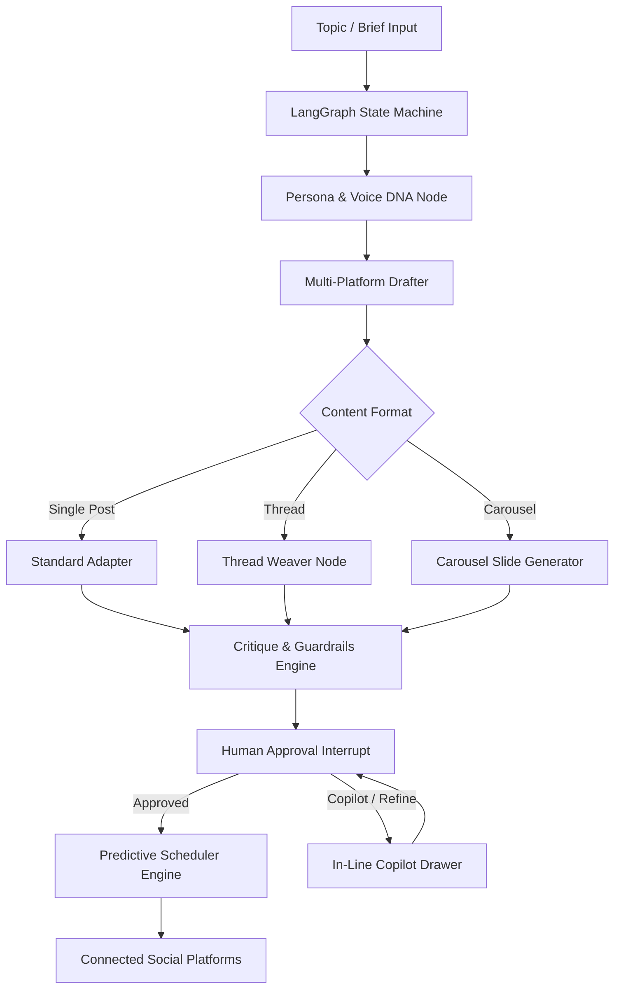

# Loopcast — Enterprise AI Social Media Command Center

An autonomous, human-governed social publishing platform powered by LangGraph state machines, deterministic brand guardrails, predictive scheduling heatmaps, and live feed simulation.

---

## Key Capabilities & 5 Advanced Features

### 1. Multi-Agent Persona & Voice Studio
- **Brand Voice Archetypes**: Switch seamlessly between Founder, AI Architect, Growth Hacker, and Executive Thought Leader voices.
- **Tone Matrix**: Fine-tune four-dimensional sliders (`Formality`, `Humor`, `Technical Depth`, `Assertiveness`).
- **Buzzword Guardrails**: Pre-execution AST filters that ban generic AI buzzwords (*"game-changer"*, *"delve"*, *"unleash"*, *"supercharge"*) before draft generation.

### 2. Multi-Platform Content Repurposer & Thread Weaver
- **X (Twitter) Thread Weaver**: Automatically generates 3-7 tweet structured threads with hook, core insights, and engagement CTAs, publishing sequentially via `in_reply_to_tweet_id` chaining.
- **LinkedIn Carousel Slide Decks**: Formats deep-dive posts into 5-slide visual carousels (*Cover*, *Problem*, *Solution*, *Metrics*, *CTA*) with per-slide aesthetic themes.
- **Format-Aware Critique**: Independent scoring rubrics for single posts, threads (rhythm & pacing), and carousels (visual density).

### 3. Smart Predictive Scheduling Engine & Heatmaps
- **7x24 Engagement Grid**: Computes audience activity heatmaps across weekdays and UTC hours for Twitter, LinkedIn, and Instagram.
- **Content-Type Boosters**: Adjusts algorithmic scores dynamically based on content format (e.g. threads +35% on Twitter, carousels +45% on LinkedIn).
- **1-Click Optimal Slot Suggestion**: Top-3 peak recommendation chips embedded directly into approval cards and scheduling modals.

### 4. Live Social Simulation Sandbox & A/B Hook Testing Lab
- **Pre-flight Hook Battle**: Run competing opening hooks through an empirical engagement simulator to forecast CTR, virality score, and sentiment distribution.
- **Realistic Feed Simulator Cards**: Interactive, pixel-perfect Twitter and LinkedIn mobile/desktop feed cards with live like/repost toggles and impression metrics.
- **Sentiment Breakdown**: Visual forecasts for positive, neutral, and critical audience reactions.

### 5. AI Social Copilot Chat & In-Line Refinement Drawer
- **Copy Doctor Actions**: 1-click tools for *Sharpen Hook* (boost CTR), *Condense 30%* (trim filler), *Add Viral CTA*, and *Viral Booster* (scannable one-liners).
- **Conversational In-Line Prompting**: Natural language chat input to adapt copy on the fly.
- **Side-by-Side Diff View**: Visual comparison highlighting original vs refined text with character count deltas.
- **Automated Copy Diagnostics**: Real-time evaluation of Hook Grade, Readability Score, and character boundary warnings.

---

## System Architecture



---

## API Endpoints Reference

| Endpoint | Method | Description |
|---|---|---|
| `/api/v1/generate` | `POST` | Trigger LangGraph pipeline with persona & format params |
| `/api/v1/posts` | `GET` | List all posts across pending, scheduled, and published states |
| `/api/v1/posts/{id}/approve` | `POST` | Approve draft and queue for optimal scheduling |
| `/api/v1/posts/{id}/review` | `POST` | Reject draft with feedback for iterative refinement |
| `/api/v1/personas` | `GET / POST` | List and create brand voice personas |
| `/api/v1/personas/{id}` | `PUT / DELETE` | Update tone sliders or delete custom personas |
| `/api/v1/best-times` | `POST` | Query 7x24 engagement heatmaps and top-3 peak slots |
| `/api/v1/simulation/ab-test` | `POST` | Simulate A/B hook performance and predict viral winners |
| `/api/v1/copilot/refine` | `POST` | Apply copy doctor actions or conversational prompts |
| `/api/v1/copilot/diagnose` | `POST` | Evaluate readability, hook power, and character bounds |
| `/api/v1/platforms` | `GET` | Retrieve OAuth connected account states |
| `/api/v1/scheduler/run-now` | `POST` | Manually sweep and dispatch due posts |

---

## Quick Start Guide

### Prerequisites
- Python 3.10+ (tested on Python 3.14)
- Node.js 18+ and npm

### Backend Setup
```bash
# 1. Install dependencies
cd backend
pip install -r requirements.txt

# 2. Seed realistic demo data (Personas, Threads, Scheduled Posts)
python backend/scripts/seed_demo_data.py

# 3. Start development server
uvicorn backend.app.main:app --reload --port 8000
```
Backend API will be live at `http://localhost:8000` (Swagger docs at `/docs`).

### Frontend Setup
```bash
# 1. Install dependencies
cd frontend
npm install

# 2. Launch Vite dev server
npm run dev
```
Frontend command center will be live at `http://localhost:5173`.

---

## Automated Test Suite

Loopcast features comprehensive test coverage spanning database models, LangGraph interrupt nodes, platform connectors, predictive analytics, simulation forecasts, and copilot refinement:

```bash
python -m pytest backend/tests/ -v
```

**Results:** `51 passed in 2.47s` (100% passing).
